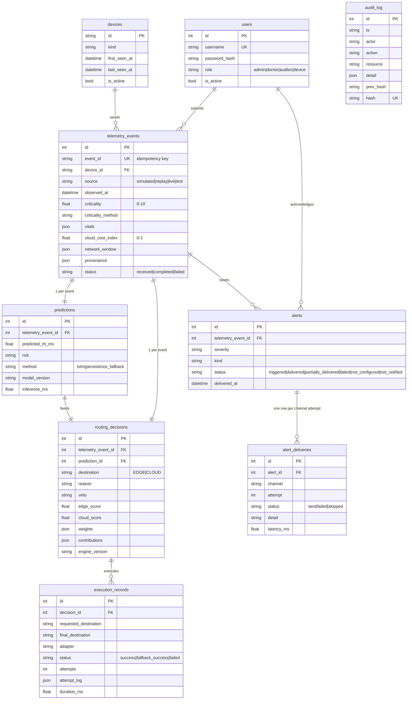

# Database schema

* **Engine:** SQLAlchemy 2.x ORM (`backend/models.py`), schema created only by Alembic (`migrations/versions/0001_initial_schema.py`).
* **Databases:** PostgreSQL 16 (Docker Compose — recommended, matches the report) and SQLite (zero-setup local runs, tests).
  Both are exercised: the automated suite runs on SQLite; the PostgreSQL run is recorded in `results/tests/postgres_smoke.txt`.
* **Initialisation:** the API runs `alembic upgrade head` at start-up (`AUTO_MIGRATE=true`), or manually:
  `DATABASE_URL=... alembic upgrade head`. `alembic check` confirms models and migrations agree (tested).

## Constraints and indexes
* CHECK: `criticality` 0–10, `cloud_cost_index` 0–1, `source` enum, `destination` EDGE/CLOUD, `role` enum.
* UNIQUE: `telemetry_events.event_id` (idempotency), one prediction and one decision per event, one alert per (event, kind), `audit_log.hash`.
* Indexes: event source/status/received_at/device, decision destination/reason/created_at, alert status/severity, audit actor/action.
* All timestamps are timezone-aware UTC; the UI converts to IST.

## Transactions and failure behaviour
1. The event row is committed **first** (`status=received`), so a later crash leaves visible evidence.
2. Prediction, decision, execution, alerts and audit entries are written in **one** transaction.
3. On any error the event is marked `status=failed` with a sanitised `error` and an `event_failed` audit entry.
4. Concurrent duplicates of the same `event_id` hit the UNIQUE constraint and are answered with the stored result.
5. Alert delivery runs after the commit (background task) and updates only the alert/delivery rows.

## Privacy
No names, MRNs or free text about patients are stored. Vitals are three numbers per event (needed to explain the
criticality score); audit `detail` never contains vitals (tested in `test_audit_detail_never_contains_vitals_or_tokens`).

## Backup / recovery
* PostgreSQL: `docker compose exec postgres pg_dump -U hcf hcf > backup.sql`; restore with `psql`. On AWS: RDS automated
  backups / PITR (not deployed).
* SQLite: stop the API and copy `runtime/app.db` (WAL mode: also copy `app.db-wal` if present).
* After restoring, run `GET /api/v1/audit/verify` and compare the head hash with the last exported checkpoint.
